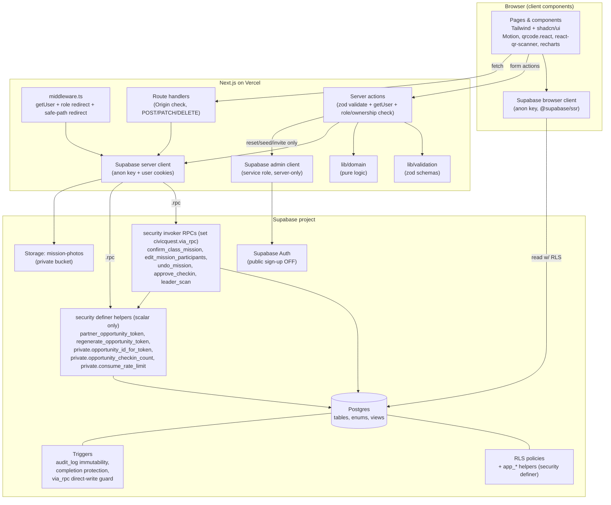
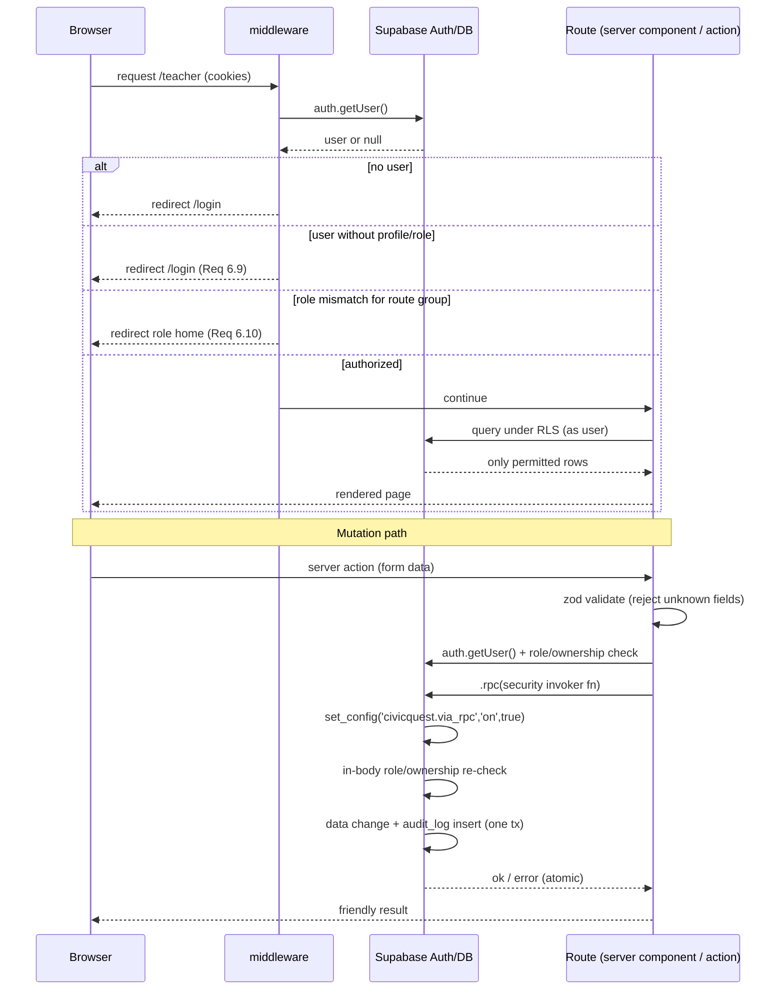

# Design Document

## Overview

CivicQuest is a Next.js App Router application backed by Supabase (Postgres, Auth, Storage, Row Level Security) that teaches civic sense to grades 2–12 through one short real-world mission per school day. This design covers **only the day-one build scope (Steps 1–7, Requirements 1–37)** plus the **stretch items (Steps 8–10, Requirements 38–40)**, which are clearly marked as stretch and are implemented only after Steps 1–7 work.

The dominant design priority is **demo reliability**. Three decisions follow directly from that priority and shape the whole design:

- **"Today's mission" is calendar-independent.** The mission a class is "on" is its next not-yet-confirmed mission in its assigned module — the lowest `day_number` whose completion is not yet confirmed — not the mission matching the wall-clock date. This lets the demo run on a weekend or any day (Requirements 18.2, 24.4).
- **Seven demo accounts, one Leader login.** Exactly seven demo accounts exist (admin, teacher3, teacher7, teacher11, counselor, partner, leader); among Grade 11 Advisory students only the demo Leader Jordan M. has a login. The landing page shows "Try the demo" buttons for all demo roles except counselor (Requirements 17.4, 16.4, 29.2).
- **Every audited mutation is atomic.** Confirm-for-class, edit-who-took-part, undo, approve-hours, and the Leader QR scan run inside `security invoker` Postgres functions so the data change and its `audit_log` entry commit or roll back together, and RLS still applies to the caller (Requirements 20.1, 21.2, 26.1, 27.1, 36.4).
- **`mission_completions` and `checkins` are written only through those RPCs.** Direct client `insert`/`update` on either table is rejected by a trigger guarding a transaction-local flag that only our RPCs set. Each RPC re-checks role and ownership inside its own body, because any signed-in browser can call it directly with `.rpc()` (Requirements 32.2, 32.4).

Because this application stores data about children, every security and child-privacy requirement is mandatory. All totals (points, stamps, hours, town placement) are recomputed on the server from server-trusted inputs; no client-supplied `points_awarded`, `status`, `confirmed_by`, `approved_by`, `hours`, `role`, `school_id`, or `level` is ever trusted (Requirements 32.4, 20.2, 26.5).

### Out of scope (explicitly not designed here)

CSV roster upload, teacher invites, quizzes, photo review, counselor page, admin reports, parent notice letter, and printable QR login cards are **out of scope** for this design. The schema still includes the columns and enum values those features will later use (e.g. `verification_type` values `quiz` and `photo_review`, `missions.quiz`, `students.login_code`, `mission_completions.photo_path`), because the migration must create the full schema from build-prompt section 3 (Requirement 2.1), but no page, server action, or RPC is designed for them in this scope.

### Stretch items (designed, built only after Steps 1–7)

- **Step 8** — class-mode avatar picker and read-only student dashboard, with QR card lookups rate-limited 10/min per teacher device (Requirement 38).
- **Step 9** — kid theme picker saved on the student row (Requirement 39).
- **Step 10** — class rewards editing with server-side validation (Requirement 40).

## Architecture

### High-level architecture

CivicQuest is a single Next.js App Router project deployed to Vercel, talking to one Supabase project. The browser never holds privileged secrets: all mutations go through server actions, and the transactional/audited mutations call `security invoker` Postgres functions via `.rpc()`. RLS is the primary data-access boundary; server actions add a second role/ownership check (Requirement 32.2).

### Request and auth flow

`middleware.ts` runs on every matched route. It refreshes the session cookie using the `@supabase/ssr` pattern, calls `supabase.auth.getUser()` (never `getSession()` alone) to verify identity on the server, and redirects based on `profiles.role`. Post-login redirect targets are passed through the pure `safeRedirectPath` helper so only a relative single-slash path is honored (Requirements 6.5, 6.12, 6.13, 32.1).

### Route groups (per role)

Route groups keep each role's pages isolated and map cleanly to the middleware role check and to `structure.md`:

- `app/(public)/` — `/` landing page, `/login`. No auth required (Requirements 29, 6.11).
- `app/(teacher)/teacher/` — Today, mission run, class view, class town/projector, roadmap; stretch `rewards`, `play` (Requirements 18–24, 40, 38).
- `app/(partner)/partner/` — opportunities, opportunity QR + approvals (Requirement 25, 27).
- `app/(leader)/me/` — hours, QR scanner, certificate (Requirements 26, 28).
- `app/(admin)/admin/` — overview, proof log (Requirement 31).

The counselor role has an account and is redirected to its home by the middleware, but no counselor page is designed in this scope (out of scope).

### Three Supabase clients (@supabase/ssr)

Exactly three clients, all via `@supabase/ssr` (Requirement 1.3):

| Client | File | Key | Use |
|---|---|---|---|
| Browser | `lib/supabase/browser.ts` | anon | Client-component reads (under RLS), live check-in polling |
| Server | `lib/supabase/server.ts` | anon + user cookies | Server components, server actions, route handlers, `.rpc()` calls as the user |
| Admin | `lib/supabase/admin.ts` | service role | Seed, demo reset, future invites only — first line `import 'server-only'` |

`lib/supabase/admin.ts` begins with `import 'server-only'` and never carries a `NEXT_PUBLIC_` identifier for the key (Requirements 1.6, 35.3). Env vars are validated at startup; if any of the five required variables is missing, startup halts naming each one (Requirements 1.4, 1.5).

### Mutation layering

1. **Server action** (`app/.../actions.ts`, `'use server'`) — entry point for every mutation (Requirement 34.1). It: (a) parses input with a `lib/validation` zod schema that rejects unknown fields; (b) calls `getUser()`; (c) checks role and ownership; (d) calls a `security invoker` RPC for transactional/audited work, or the Supabase query builder for simple writes. These checks give friendly early errors but are **not** the security boundary for RPC-backed writes, since the RPCs are directly callable.
2. **`security invoker` RPC** — for confirm/edit/undo/approve/scan, where a data change plus an `audit_log` insert must be one atomic transaction under the caller's RLS (Requirements 20.1, 21.2, 26.1, 27.1, 36.4). Each RPC sets the `civicquest.via_rpc` flag and re-checks role and ownership in its own body.
3. **`lib/domain`** — pure functions (points, stamps, hours, levels, town, sanitizing, redirect) used by server actions and mirrored by the RPCs' SQL so the server, not the client, computes every total.
4. **`lib/validation`** — zod schemas shared across actions.
5. **`supabase/migrations/`** — schema, RLS, triggers, views, and the RPC definitions.

## Data Models

The schema is applied as one Supabase SQL migration under `supabase/migrations/` and must contain every object in build-prompt section 3 (Requirement 2.1). Key points below; see build-prompt section 3 for exact column SQL.

### Enums (Requirement 2.2)

- `user_role`: `admin`, `teacher`, `counselor`, `partner`, `student`.
- `verification_type`: `class_activity`, `quiz`, `photo_review`, `qr_checkin`. (Only `class_activity` and `qr_checkin` have built flows in this scope; the other two exist for the schema and future steps.)
- `review_status`: `pending`, `approved`, `rejected`, `reversed`.

### Tables

`schools`, `partner_orgs`, `school_partners`, `profiles`, `classes`, `class_rewards`, `students`, `modules`, `missions`, `class_modules`, `mission_completions`, `opportunities`, `checkins`, `badges`, `student_badges`, `audit_log`, `rate_limits`.

Constraints enforced at the database (Requirement 2.4, 2.6): `students.first_name` 1–50 chars, `students.last_initial` exactly 1 char, `class_rewards.reward` ≤ 140 chars, `classes.grade`/`students.grade` in 2–12, `missions.day_number` in 1–5, unique `(mission_id, student_id)` on `mission_completions`, unique `(opportunity_id, student_id)` on `checkins`. Any violating write is rejected unchanged with an error naming the constraint.

### Generated level column (Requirement 2.3)

`students.level` is a **stored generated column**: `learners` for grade 2–5, `helpers` for 6–8, `leaders` for 9–12. The database is the source of truth for level; the pure `gradeToLevel` function mirrors the same boundaries for UI and server computation, and `level` is never accepted from the client (Requirement 32.4).

### Views (`security_invoker = true`) (Requirement 2.5)

- `class_points` — per class: `student_count` and `total_points` (sum of approved `points_awarded`). Basis for the leaderboard (Requirement 23).
- `class_town` — one row per distinct approved mission for a class: `town_item` and `placed_at = min(confirmed_at)`, so each distinct approved mission contributes exactly one building ordered by placement time (Requirements 22.2, 11).
- `student_stamps` — per student and quality, count of approved completions (stamp passport).
- `student_hours` — per student: `verified_hours` (sum of approved `checkins.hours`) and `pending_hours` (sum of pending), exposing only first name, last initial, and grade.

Declaring the views `security_invoker = true` means they run under the querying user's RLS, so a view can never leak across schools.

### RLS helper functions (`security definer`, `search_path = ''`)

`app_role()`, `app_school_id()`, `app_partner_org_id()`, and `app_student_id()` read `profiles`/`students` for `auth.uid()`. They are declared `security definer` with `search_path = ''` and fully qualified table names (Requirement 3.2). They are `security definer` specifically so a policy can learn the caller's role/school/org/student id **without** granting the caller direct read access to those lookup rows — the function runs as its owner, returns a single scalar, and leaks nothing else. Policies then compare that scalar to each row (Requirements 3.3–3.10):

- Admin/counselor: read rows where `school_id = app_school_id()`; admin writes classes/students/rewards/profiles in own school.
- Teacher: read/write only rows for classes they own (`classes.teacher_id = auth.uid()`), including those classes' students, rewards, class modules, completions.
- Partner: read/write only own org's opportunities and check-ins.
- Leader (student): read only own student row, completions, stamps, check-ins, badges, plus opportunities from partners linked to their school.
- Modules/missions with `school_id is null`: readable by any signed-in user.
- Cross-school reads return zero rows (Requirement 3.10).

### Partner student-detail view/function (Requirement 3.7)

RLS restricts rows but **cannot hide columns**, so partners must never get column access to the `students` table. Partner check-in detail is served only through a dedicated, column-limited surface — `partner_checkin_students` (a view, or a `security invoker` function `partner_checkin_students(opportunity_id uuid)`) — that returns **exactly** `first_name`, `last_initial`, `grade` for students who checked in to the partner's own org's opportunities, and nothing else. Partners are granted select on this surface, not on `students`.

### QR token secrecy: column privileges on `opportunities` (Requirements 25.2–25.4, 26.4)

Leaders may read `opportunities` rows from partners linked to their school (Requirement 3.8), and RLS cannot hide columns. Without a column restriction a Leader could read `qr_token` and "check in" from home. The migration therefore uses column-level privileges:

- `revoke select, insert, update on public.opportunities from anon, authenticated;` then `grant select (id, partner_org_id, title, description, location, starts_at, ends_at, min_grade, capacity, created_at) on public.opportunities to authenticated;` and matching column-list `insert`/`update` grants (excluding `qr_token`) for partners' own-org writes under RLS. A table-level `select` grant would override a column revoke, so the table-level grant is revoked first and only the column list is granted. Client code always uses explicit column lists (never `select *`) on `opportunities`.
- `qr_token` has a database default of `encode(extensions.gen_random_bytes(24), 'hex')`, so new opportunities get a crypto-random token without the client ever supplying one.
- **`partner_opportunity_token(p_opportunity_id uuid) returns text`** — `security definer`, `search_path = ''`, in `public` (called by the partner page via `.rpc()`). Returns the token only if `public.app_role() = 'partner'` and the opportunity's `partner_org_id = public.app_partner_org_id()`; otherwise returns null. Returns one scalar, no rows.
- **`regenerate_opportunity_token(p_opportunity_id uuid) returns void`** — `security definer`, `search_path = ''`, in `public`. Checks the same partner ownership in its body (raises "not permitted" otherwise), sets `qr_token = encode(extensions.gen_random_bytes(24), 'hex')`, and writes an `audit_log` entry (`action = 'regenerate_token'`, no token value logged). The previous token stops matching immediately (Requirement 25.3, 25.4). It is `definer` because `authenticated` has no `update` privilege on `qr_token`.
- **`private.opportunity_id_for_token(p_token text) returns uuid`** — `security definer`, `search_path = ''`. Returns the id of the opportunity whose **current** `qr_token` equals `p_token`, or null. Used only inside `leader_scan`.
- **`private.opportunity_checkin_count(p_opportunity_id uuid) returns integer`** — `security definer`, `search_path = ''`. Returns only the number of check-ins for the opportunity, so `leader_scan` can enforce `capacity` even though the Leader cannot see other students' check-ins under RLS.
- **`private.consume_rate_limit(p_bucket text, p_limit int, p_window interval) returns boolean`** — `security definer`, `search_path = ''`. Keys the counter on `auth.uid()` internally (the caller cannot name another user's key), increments the `rate_limits` row for the current window, and returns whether the call is within the limit.

The three `private.*` helpers live in a `private` schema that is **not** in PostgREST's exposed schemas, so they are not reachable via `.rpc()`; `authenticated` gets `usage` on the schema and `execute` on these functions only so our invoker RPCs can call them. `execute` on every helper is revoked from `anon`.

### Triggers

- **`audit_log` immutability** (Requirement 4.1, 4.2): the table has insert and select policies only; a `before update or delete` trigger raises an error stating rows are immutable and leaves the row unchanged.
- **Direct-write guard on `mission_completions` and `checkins`** (Requirements 32.2, 32.4, 32.5, 36.4): a `before insert or update` trigger on **each** table raises "writes to this table must go through CivicQuest actions" unless `current_setting('civicquest.via_rpc', true) = 'on'`, or the database role is `service_role` (see "Service-role exemption" below). Deletes on `mission_completions` remain blocked by the existing `before delete` trigger.
- **`mission_completions` protection** (Requirement 4.3–4.9): a trigger blocks changes to protected columns (`status`, `points_awarded`, `confirmed_by`, `confirmed_at`) unless the caller is the class's teacher or a school admin. Status transitions:
  - `approved → reversed` — unchanged: by the class's teacher within 24h of `confirmed_at`, or by a school admin with no time limit; requires a 1–500 char reason and writes exactly one `audit_log` entry.
  - `reversed → approved` — allowed **only** when `current_setting('civicquest.via_rpc', true) = 'on'`, i.e. inside `confirm_class_mission` or `edit_mission_participants`, which set fresh server-computed `points_awarded`, `confirmed_by = auth.uid()`, and `confirmed_at = now()`. Any other `reversed → approved` transition is rejected unchanged.
  - Any other status transition, or a late teacher reversal, is rejected unchanged.
  - A `before delete` trigger forbids deleting completion rows (they are only ever `reversed`).

### Service-role exemption (seed and demo reset)

The seed script and the demo reset run server-side with the service role key, which reaches Postgres as the `service_role` database role (it bypasses RLS but not triggers). **Decision:** the direct-write guard and the completion-protection trigger exempt callers where `current_user = 'service_role'` (equivalently `auth.role() = 'service_role'`), so seeded history and resets can write approved completions and check-ins directly. This is safe because the service role key is server-only (`import 'server-only'`, never `NEXT_PUBLIC_`) and used only by the seed, the reset, and future admin invites (Requirements 1.6, 35.3). No other role is exempt — not `authenticated`, `anon`, or even `postgres`; seed/reset must therefore use the admin Supabase client, not a raw database connection. The `audit_log` immutability trigger is **not** exempt for any role.

### Two Today-view lookups: recently confirmed and next

The class's position in its module is derived, not stored, from two separate server lookups (a server helper, optionally backed by views):

- **Recently confirmed (< 24h)** — `class_recent_confirmation`: within the class's assigned module, the mission (if any) whose **mission confirmation time** is less than 24 hours ago. The mission confirmation time is `min(confirmed_at)` over that mission's currently `approved` completions for the class, so students added later by an edit do not extend the window, while a re-confirm after undo starts a fresh window (all rows re-approved with a fresh `confirmed_at`). This lookup drives "Done today", "Edit who took part", "Undo", and the 24h gate in the RPCs (Requirements 21.1, 21.9).
- **Next not-yet-confirmed** — `class_next_mission`: within the class's assigned module (`class_modules`), ordered by `day_number`, the lowest `day_number` with **no** `approved` completion for the class. Calendar-independent, so the demo works any day (Requirements 18.2, 24.4). An undone mission has no approved completions, so it becomes "next" again (Requirement 21.8). If every mission is confirmed, this lookup returns null and the class is **module complete**.

What counts as "confirmed" (at least one `approved` completion for the mission and class) is the same rule the domain equivalence helpers model.

## Security-Invoker RPC Functions

Five Postgres functions perform the transactional, audited writes to `mission_completions` and `checkins`: `confirm_class_mission`, `edit_mission_participants`, `undo_mission`, `approve_checkin`, and `leader_scan`. Each is declared **`security invoker`** (not `security definer`), so it executes with the privileges and RLS of the calling user. Each performs its data change **and** its `audit_log` insert inside a single implicit transaction (the function body), so both commit together or both roll back (Requirements 20.1, 21.2, 26.1, 27.1, 36.4). All are called from server actions via `supabase.rpc(...)` with named parameters; no SQL is ever built from strings, and no RPC uses dynamic SQL (Requirement 33.3).

### Common preamble for all five RPCs

Every one of the five RPCs begins with the same steps, in this order:

1. `perform set_config('civicquest.via_rpc', 'on', true);` — the third argument `true` makes the setting **transaction-local**, so it disappears when the RPC's transaction ends.
2. `auth.uid()` must be non-null; otherwise raise "sign in required" (Requirement 32.3).
3. **In-body role and ownership check** (see each RPC). Failure raises a friendly "not permitted" error and, because the function is one transaction, nothing persists.

### Why the client cannot set the flag itself

- PostgREST exposes only functions in the configured API schemas (`public`), never `pg_catalog`, so `pg_catalog.set_config` is not callable via `.rpc()`. A raw `insert`/`update` request through PostgREST cannot run `set_config` either.
- Each PostgREST request runs in its own transaction, and the flag is transaction-local. A client cannot call one of our RPCs to set the flag and then issue a direct write in the same transaction.
- Our RPCs call `set_config` only with the constant arguments above, never with caller input.
- **Rule:** no function in the `public` schema (or any exposed schema) may wrap or forward to `set_config`, apart from the five RPCs setting this one constant flag. The SQL test script asserts this by scanning `pg_proc` (see Testing Strategy).

### In-body ownership checks (server-action checks are bypassable)

The RPCs are `security invoker` and live in `public`, so any signed-in browser can call them directly with the anon key and its own JWT, skipping the server action entirely. The server action's role/ownership check is therefore a convenience for friendly errors, **not** the boundary. Each RPC re-checks inside its body, in addition to RLS:

| RPC | In-body check |
|---|---|
| `confirm_class_mission` | `app_role() = 'teacher'` and `classes.teacher_id = auth.uid()` for `p_class_id`; `p_mission_id` belongs to the class's assigned module; every id in `p_present_student_ids` is a student of `p_class_id` |
| `edit_mission_participants` | same as confirm, plus the mission's confirmation time (`class_recent_confirmation`) is < 24h ago |
| `undo_mission` | caller is the class's teacher and the mission's confirmation time is < 24h ago, **or** `app_role() = 'admin'` and the class's `school_id = app_school_id()` (no time limit, Requirements 4.5, 21.9) |
| `approve_checkin` | `app_role() = 'partner'`; the check-in's opportunity has `partner_org_id = app_partner_org_id()`; the check-in's student is not linked to the caller (no self-approval) |
| `leader_scan` | `app_role() = 'student'` and `app_student_id()` is non-null; the student's level is `leaders` |

### Why `security invoker` here, and how it differs from the `security definer` helpers

The `app_*` helper functions are `security definer` because their job is to answer "who is the caller?" by reading lookup rows the caller may not otherwise read — they return a single scalar and nothing else, so running as owner is safe and necessary. The five write RPCs are the opposite case: they touch the caller's **own** data (their class's completions, their org's check-ins, their own check-in), and we want every row they write or change to be subject to the **caller's** RLS policies, the direct-write guard, and the `mission_completions` protection trigger. `security definer` would bypass RLS and run as the function owner, defeating the per-teacher/per-partner/per-Leader isolation that is the core child-data protection. `security invoker` keeps RLS in force and still gives atomicity, because atomicity comes from the function being one transaction — not from the security mode.

The token and capacity helpers (`partner_opportunity_token`, `regenerate_opportunity_token`, `private.opportunity_id_for_token`, `private.opportunity_checkin_count`, `private.consume_rate_limit`) follow the `app_*` pattern and are acceptable as `security definer` for the same reason: each has `search_path = ''`, fully qualified names, its own ownership check where relevant, and returns a single scalar (a token, an id, a count, a boolean, or nothing). None returns rows, so none can leak another student's or another org's data.

### `confirm_class_mission` (Requirements 20.1, 20.2, 20.7, 20.8, 15.2, 36.3)

- **Parameters:** `p_class_id uuid`, `p_mission_id uuid`, `p_present_student_ids uuid[]`.
- **Server recomputes, never trusts client:** points per present student from the mission's level (10 learners/helpers, 15 leaders), one stamp of the module quality per present student, `status = 'approved'`, `confirmed_by = auth.uid()`, `confirmed_at = now()`, `school_id` from the class. Any client-sent `points_awarded`, `status`, `confirmed_by`, `school_id`, or `level` is ignored (Requirement 20.2).
- **Atomic body (upsert):** preamble; de-duplicate `p_present_student_ids` to a distinct set; then `insert ... on conflict (mission_id, student_id) do update` per present student:
  - no row → insert `approved` with server-computed values;
  - existing `reversed` row → set back to `approved` with **fresh** `points_awarded`, `confirmed_by = auth.uid()`, `confirmed_at = now()` (allowed by the protection trigger only because the via_rpc flag is set), and write an `audit_log` entry (`action = 're_approve'`);
  - existing `approved` row → left unchanged (the `do update ... where status = 'reversed'` clause skips it), so re-confirming never double-awards (Requirement 20.8).
  
  Insert one `audit_log` row (`action = 'confirm'`) when at least one row changed. All within the one transaction; on any failure nothing persists (Requirement 20.6).
- **Undo then re-confirm** reaches exactly the state of a fresh confirm: every row is `approved` with server-computed points and a fresh `confirmed_at` (Requirement 15.2).
- **RLS/ownership:** in-body check above, plus teacher RLS and the completion-protection trigger; a non-teacher or non-owning teacher is rejected with no side effects (Requirement 20.7). The town building and stamps are derived by the `class_town`/`student_stamps` views from approved completions, so there is no separate town row to write.

### `edit_mission_participants` (Requirements 21.2, 21.3, 21.4, 21.5, 15.3)

- **Parameters:** `p_class_id uuid`, `p_mission_id uuid`, `p_present_student_ids uuid[]` (the new roster set B).
- **Atomic body:** preamble; for students in B, apply the same upsert as `confirm_class_mission` — no row → insert `approved`; `reversed` row (e.g. a student removed by an earlier edit and now re-added) → re-approve with fresh server-computed values and an `audit_log` entry; `approved` row → unchanged. For students previously approved and not in B, set `status = 'reversed'` with reason `'removed by edit'` and an `audit_log` entry each. Editing from set A to set B yields exactly the totals of confirming B directly (Requirement 15.3), independent of A.
- **Failure:** any error rolls the whole function back; no partial roster change persists (Requirement 21.5).

### `undo_mission` (Requirements 21.6, 21.7, 21.8, 21.9, 4.5)

- **Parameters:** `p_class_id uuid`, `p_mission_id uuid`, `p_reason text`.
- **Validation:** for a teacher caller, `p_reason` must be exactly one of `'pressed by mistake'`, `'the activity didn't happen'`, `'wrong class'`; any other value is rejected with no changes (Requirement 21.7). For an admin caller reversing from the proof log, `p_reason` must be 1–500 characters (Requirement 4.7, 4.8). The < 24h window for teachers is enforced in the function body, not only the server action (Requirement 21.1, 21.9).
- **Atomic body:** preamble; mark **all** of that mission's `approved` completions for the class `reversed`; the `class_town`/`student_stamps`/`class_points` views then naturally drop the building, stamps, and points; the mission returns to "not done" (the next-not-yet-confirmed lookup again selects it); write one `audit_log` entry carrying the reason. Undo then re-confirm restores exact prior state (Requirement 15.2).

### `approve_checkin` (Requirements 27.1–27.4, 32.6)

- **Parameters:** `p_checkin_id uuid`.
- **Guards:** preamble; reject if the check-in's opportunity is not the partner's own org (Requirement 27.2); reject if the approver is approving their own work (Requirement 27.3, 32.6); reject if the check-in is not `pending` or has no `check_out_at` (Requirement 27.4).
- **Atomic body:** set `status = 'approved'`, `approved_by = auth.uid()`, `approved_at = now()` — all server-set, ignoring any client `hours`/`status`/`approved_by` (Requirement 26.5); write one `audit_log` entry (`action = 'approve'`). Verified hours become visible via `student_hours` only after approval (Requirement 26.6).

### `leader_scan` (Requirements 25.4, 26.1–26.7, 35.1, 35.2)

- **Parameters:** `p_token text`. **Returns:** `jsonb` `{ action: 'checked_in' | 'checked_out', opportunity_title text, hours numeric | null }`. Never returns the token, ids of other students, or any other student's data.
- **Atomic body:**
  1. Preamble (flag, signed in, caller is a Leader with `app_student_id()`).
  2. **Rate limit (inside the RPC):** `private.consume_rate_limit('leader_scan', 10, interval '1 minute')`; if false, raise "Too many scans. Wait a minute and try again." Enforcing it in the RPC means direct `.rpc()` calls are limited too (Requirement 26.7, 35.2).
  3. Resolve `v_opp_id := private.opportunity_id_for_token(p_token)`; null → raise "This code isn't valid. Ask the partner for the current code." Only the opportunity's **current** `qr_token` matches, so regenerated codes stop working (Requirement 25.4, 26.3).
  4. Load the opportunity's non-secret columns under the Leader's RLS, and the Leader's own student row.
  5. If the Leader already has a check-in for this opportunity: if `check_out_at` is null → **check out**: set `check_out_at = now()` and `hours = least(8, floor(extract(epoch from (now() - check_in_at)) / 900) * 0.25)` clamped at ≥ 0 (mirrors `computeHours`, Requirement 26.2); status stays `pending`; `audit_log` entry `action = 'check_out'`. If `check_out_at` is already set → raise "You've already checked out of this event."
  6. Otherwise → **check in**, after eligibility (Requirement 26.4): an `exists` on `public.school_partners` for the Leader's school and the opportunity's `partner_org_id` (Leaders have select on their own school's links); student `grade >= min_grade`; `capacity is null or private.opportunity_checkin_count(v_opp_id) < capacity`; `now()` between `starts_at - interval '30 minutes'` and `ends_at`. Any failure raises a specific friendly message (not linked / grade / full / not open yet or ended). On success insert `{ opportunity_id, student_id = app_student_id(), check_in_at = now(), status = 'pending' }`; `audit_log` entry `action = 'check_in'`.
- **Never trusts client:** the only input is the token; `student_id`, timestamps, `hours`, and `status` are all server-set (Requirement 26.5, 32.4, 32.5). The window check applies to the check-in scan; a check-out may happen after `ends_at`, with hours still capped at 8 and pending partner approval (Requirement 26.6).
- **Concurrency:** the `(opportunity_id, student_id)` unique key makes a double-tap on the first scan insert at most one row; the losing request rolls back and shows "You're already checked in."

### Server-side recomputation (never trust client)

For every RPC, the magnitude values (points, stamps, hours) are computed in SQL from the mission's level, the module's quality, and the check-in timestamps — mirroring `lib/domain` — and status/actor/timestamp fields are set from `auth.uid()` and `now()`. The client only ever supplies **identifiers, the present-set membership, a reason, or a QR token**; it never supplies amounts or statuses (Requirements 20.2, 26.5, 32.4).

## Domain Layer (`lib/domain`)

Pure, side-effect-free functions, each unit- and property-tested with fast-check (Requirements 8–15). They are the single source of the rules; server actions call them and the RPCs mirror them in SQL.

| Function | Signature (TypeScript) | Validates | Property test (fast-check) |
|---|---|---|---|
| `gradeToLevel` | `(grade: number) => Level \| {rejected:true}` | Req 8 | Every integer 2–12 maps to exactly one level; boundaries 5/6 and 8/9 in non-overlapping bands; non-integer/out-of-range rejected, never throws (Req 8.6) |
| `computePoints` | `(presentIds: string[], level: Level) => number` | Req 9 | Total = per-student amount × distinct present count; duplicates counted once; empty set → 0 (Req 9.7) |
| `computeStamps` | `(presentIds: string[], quality: Quality) => Stamp[]` | Req 9 | One stamp per distinct present student; absent students get none (Req 9.7) |
| `computeHours` | `(checkInAt: Date, checkOutAt: Date) => number` | Req 10 | Never negative, always multiple of 0.25, never > 8, never > real elapsed; reversed pairs → 0 (Req 10.6) |
| `placeTown` | `(missions: MissionRef[], gridCapacity: number) => TownCell[]` | Req 11 | Never exceeds capacity; never duplicates a mission; identical cell assignment regardless of order (Req 11.6) |
| `townStage` | `(buildingCount: number) => {stage, gridSize} \| {rejected:true}` | Req 12 | Monotonic non-decreasing as count rises; negative/non-integer rejected, never throws (Req 12.6, 12.8) |
| `sanitizeCsvCell` | `(value: string) => string` | Req 13 | Output never starts with `= + - @` tab or CR; safe values unchanged; empty → empty (Req 13.5) |
| `safeRedirectPath` | `(path: string) => string` | Req 14 | Non relative-single-slash paths always rejected to `/` (Req 14.4) |
| `applyConfirm` / `applyUndo` / `applyEdit` (equivalence helpers) | pure state transitions over a per-mission map `studentId → {status, points}` plus derived `{points, stamps, townSet}`, given a present **set**; `applyConfirm`/`applyEdit` model the RPC upsert (missing or `reversed` → `approved` with fresh values; `approved` unchanged) | Req 15, 20.8, 21.3 | confirm-then-undo restores exact prior state; undo-then-re-confirm equals a fresh confirm; confirm is idempotent; edit A→B equals confirm B directly, including students re-added after removal; order of the present set never affects totals (Req 15.4) |

`gradeToLevel` and `townStage` return explicit rejection results rather than throwing, so callers handle invalid input deterministically. `placeTown` is given the capacity (36 on 6×6, 64 on 8×8) from `townStage`, keeping grid growth to 8×8 at 36 buildings a single source of truth (Requirement 11.3, 12.5).

## Components and Interfaces

All text renders through React; `dangerouslySetInnerHTML` is never used with user data, and only `http`/`https` links are allowed (Requirements 19.7, 29.5, 34.4, 34.5). Projector screens fill the viewport with text ≥ 2rem (design.md).

### Teacher Today view — `/teacher` (Requirement 18)

Lists each class the signed-in teacher owns, with a mini town preview per class. Each class card is built from the two separate lookups described in Data Models (`class_recent_confirmation` and `class_next_mission`), and shows one of three layouts:

1. **Confirmed < 24h ago** — a "Done today" card for that mission (module, day, quality) with **no** Start button (Requirement 18.3), plus "Edit who took part" and "Undo" controls (Requirement 21.1). **Below it**, the class's next not-yet-confirmed mission with module, day, quality, estimated minutes, proof type, and its own large "Start mission" button (Requirement 18.2).
2. **No confirmation in the last 24 hours** — only the next not-yet-confirmed mission with "Start mission" (Requirement 18.2). Edit/Undo are hidden (Requirement 21.9).
3. **Module complete** — every mission in the assigned module is confirmed (`class_next_mission` is null): a module-complete state with no Start button. If the last mission was confirmed < 24h ago, its "Done today" card with Edit/Undo still appears above it.

"Next" is always calendar-independent (Requirement 18.2, 24.4). After an Undo the undone mission disappears from "Done today" and reappears as "next". No classes → empty state (Requirement 18.4). A non-owning requester gets no class data (Requirement 18.5). The view also shows a "Today's proof log" panel (Requirement 21.10).

### Three-step mission run — `/teacher/class/[id]/run/[missionId]` (Requirement 19)

Three ordered, projector-sized steps, one at a time:

1. **Story:** story/case study + discussion question, with the Pip illustration for Learners, and "Show today's mission" (Requirement 19.2).
2. **Mission:** title, quality, instructions, and "We finished the activity" (Requirement 19.3).
3. **Who took part:** full roster, all checked by default, with "Select everyone" and "Clear all"; if the roster fails to load, show an error and block confirmation until it loads (Requirements 19.4, 19.5).

The Safe Streets day-1 Pip comic is an inline **SVG** using only original characters (a stylized fox at a curb, three panels: stop / look / listen), rendered in React (Requirements 19.6, 37.5).

### Confirm + celebration (Requirement 20)

"Confirm for class" calls the `confirm_class_mission` RPC with the student ids checked **at the moment of activation**. On success, a Motion **balloon celebration** plays — one balloon per present student up to a maximum of 28 — followed by the building dropping into the town; with `prefers-reduced-motion`, a static celebration message replaces the animation (Requirements 20.3, 20.4). The saved mission record then shows who confirmed it and who was absent (Requirement 20.5). On failure, nothing changes and an error shows (Requirement 20.6).

### Edit / Undo UI + today's proof log (Requirement 21)

- **Edit who took part** reopens the roster with the saved selection and calls `edit_mission_participants`.
- **Undo** requires exactly one of the three reasons via a constrained control and calls `undo_mission`.
- The **Today's proof log** panel lists confirmations, edits, and undos in reverse chronological order with timestamps (Requirement 21.10).

### Class view, town, projector, rewards display — `/teacher/class/[id]` (Requirement 22)

Roster, class town (one building per distinct approved mission on a 6×6 grid, current stage, progress to next stage), rank, module progress, and the 10 most recent mission records newest-first. Zero approved missions → empty town. `/teacher/class/[id]/town` is the full-screen projector town showing town, stage, and next reward. Village/town/city rewards display with their stages.

### Leaderboard (Requirement 23)

Classes ranked within the school by points per student (total approved points ÷ enrolled students; zero students → 0), descending; ties share a rank and order by class name. Visible only within the school; Learners classes never show individual student rankings.

### Roadmap — `/teacher/roadmap` (Requirement 24)

Read-only, no data-mutating controls. Each module is a **transit line**, each day a **station**; selecting a station shows that day's story, discussion question, instructions, proof type, stamp quality, and town building. The class's **next not-yet-confirmed mission** (lowest unconfirmed `day_number`) is marked as the current station (a dark dot with a yellow ring per design.md). Teacher level with no modules → empty state; non-teachers denied (Requirements 24.5, 24.6).

### Partner opportunity — `/partner/opportunity/[id]` (Requirements 25, 27)

A large QR code (from `qrcode.react`) whose value comes from `partner_opportunity_token(p_opportunity_id)` (the token is never selected from the table, Requirement 25.2); a "Make a new code" control that calls `regenerate_opportunity_token`, issuing a fresh crypto-random `qr_token` and immediately invalidating the old one (Requirement 25.3, 25.4); a live check-in list refreshing at least every 10 seconds (browser-client polling); and an "Approve hours" control per row and for everyone (each calling `approve_checkin`). Partners see only own-org opportunities/check-ins (Requirement 25.5) and check-in student detail only via the `partner_checkin_students` surface.

### Leader pages — `/me`, `/me/scan`, `/me/certificate` (Requirements 26, 28)

- `/me` — verified hours, pending hours, badges, upcoming opportunities, and today's proof timeline (check-in, check-out, who approved); empty timeline when no activity today.
- `/me/scan` — camera QR scanner (`@yudiel/react-qr-scanner`). A decoded code is sent to a server action that validates it with zod (non-empty string, bounded length) and calls `leader_scan(p_token)`. The first valid scan of an opportunity's **current** code checks in; a second valid scan checks out (hours = elapsed rounded down to 0.25, capped at 8, still pending). The page shows the RPC's small result ("Checked in to {title}" / "Checked out of {title}: {hours} hours, waiting for approval"). Unreadable codes, old codes, ineligible scans (not school-linked, below `min_grade`, full, outside 30 min before `starts_at` to `ends_at`), a scan after check-out, and the **10/min per Leader** rate limit each show a friendly message and record nothing (Requirements 26.1–26.7). All checks run inside `leader_scan`, so they also apply to direct `.rpc()` calls.
- `/me/certificate` — printable certificate listing only the signed-in Leader's approved hours; a Leader cannot see another Leader's data (Requirement 28.4).

### Landing, demo logins, reset — `/` (Requirements 29, 30)

Public landing page describing the concept, the Massachusetts civics project requirement, the three levels, and the "coming next" Google Classroom/Clever note. While `DEMO_MODE=true`, one "Try the demo" button per demo role **except counselor** (admin, teacher3, teacher7, teacher11, partner, leader); selecting one signs in as that demo account and redirects to its home. A "Reset demo data" action is shown only in demo mode. Both are hidden when demo mode is off (Requirements 29.4, 30.6).

### Admin overview + proof log — `/admin` (Requirement 31)

Overview: total students in the admin's school, missions confirmed in the most recent 7-day period, total verified hours, the class leaderboard, and Civics Project progress (recharts used here only). `/admin/proof-log` pages the append-only log newest-first. Cross-school requests return nothing; non-admins are redirected to their own home.

### Stretch pages

- `/teacher/class/[id]/play` (Step 8) — class-mode avatar picker + read-only student dashboard (points, stamp passport, badges, today's mission, 10 recent with who confirmed), sticker skin; requires the class's teacher signed in on the device; QR card lookups rate-limited 10/min per teacher device; no accounts created for Learners/Helpers (Requirement 38).
- Kid theme picker on that dashboard (Step 9, Requirement 39).
- `/teacher/class/[id]/rewards` (Step 10) — edit village/town/city rewards, each validated non-empty and ≤ 140 chars on the server; non-owning teacher denied (Requirement 40).

## Design System

CivicQuest ships one component set with two skins, selected by a layout-wrapper attribute, and four kid themes (Requirement 7, design.md).

### Two skins

- **Calm skin** (`data-skin="calm"`) — teacher, admin, partner, counselor, and Leader screens by default. Fonts: Overpass 700/800 for headings/buttons, Public Sans 400/700 for body (body ≥ 16px). Shapes: 8–12px radius, 1px borders, no shadows. The roadmap transit line uses a dark "today" dot with a yellow ring.
- **Sticker book skin** (`data-skin="sticker"`) — the class-mode student dashboard/passport and every projector screen (story, mission, balloons, class town). Fonts: Baloo 2 800 for headings/names, Lexend 400/600 for body (kid text ≥ 18px, buttons ≥ 64px tall). Shapes: 2.5px ink outlines, 4–6px solid offset shadows, 18–26px radius, pill buttons, dot-grid background. Kid screens always use a light background (`--kid-bg #EEFAF8`) even in device dark mode.

All colors are CSS variables defined on `:root` with light and dark values (dark under `@media (prefers-color-scheme: dark)` guarded as `:root:not([data-theme="light"])` and under `:root[data-theme="dark"]`) — matching the token tables in design.md exactly (Requirement 7.1). The skin is set with `data-skin`, the kid theme with `data-kid-theme` (Requirement 7.2).

### Four kid themes (`data-kid-theme`)

| Theme | Primary | Secondary | Highlight |
|---|---|---|---|
| Hero | `#E63946` | `#1D3557` | `#FFD166` |
| Bubblegum | `#FF5FA2` | `#8B5CF6` | `#FFD6E8` |
| Ocean | `#0EA5E9` | `#14B8A6` | `#CFFAFE` |
| Classic (default) | `#2F8F5B` | `#1D2B4F` | `#F5B700` |

Text on primary/secondary is white; text on highlight is `#22223B`. Themes are original — no copyrighted characters, brand names, or signature motifs (Requirement 37.5).

### Icons (Fluent Emoji 3D, self-hosted)

Microsoft Fluent Emoji 3D PNGs are downloaded into `public/icons/` and served **only from the app origin**, because the CSP allows images only from the app itself and the Supabase Storage domain (Requirements 7.3, 6.1). An `Icon` component maps each defined icon name to its file in `public/icons/`; an unknown name renders a fallback placeholder without throwing (Requirements 7.4, 7.5). Fluent Emoji is credited in the README (Requirement 7.6).

**Town item → icon** (design.md): tree → deciduous tree, park → national park, bench → chair, crosswalk → person walking, library → classical building, clinic → hospital, bus stop → bus stop, recycling center → recycling symbol, community garden → seedling, playground → playground slide, food bank → canned food, school → school, bike lane → bicycle, fire station → fire engine.

**Badge → icon** (design.md): Safety → shield, Kindness → star, Helping → handshake, Responsibility → light bulb, Respect → people hugging, Civic action → classical building. Locked badges render greyscale at 40% opacity.

Pip the fox uses the 3D fox; student avatars use the 3D animal set. Balloons in the celebration use the balloon icon.

### Responsive rules (both skins)

Mobile first, breakpoints at 640px and 1024px. Phones: one column, sticky bottom action on mission screens, bottom tab bar on `/me` and the student dashboard. Laptops: two or three columns, max content width 1040px. Projector screens fill the viewport with text ≥ 2rem. Tap targets ≥ 48px everywhere, ≥ 64px on kid screens. No horizontal page scrolling except the week strip.

### CSP constraint on images

Because the Content Security Policy permits images only from the app origin (and the Supabase Storage domain for mission photos), **all** decorative and icon imagery must be self-hosted under `public/`; no third-party image or font CDN is referenced except Google Fonts for the typefaces (Requirements 6.1, 7.3).

## Security Design

Every item below is mandatory (this app stores children's data). Each maps to a cross-cutting requirement.

### Headers and CSP (Requirements 6.1, 6.2)

`next.config` sets, on every route: a CSP allowing scripts only from the app origin, fonts from Google Fonts, images from the app origin and the Supabase Storage domain, and connections only to the Supabase project origin; plus `frame-ancestors 'none'`, `X-Frame-Options: DENY`, `Strict-Transport-Security: max-age=63072000; includeSubDomains; preload`, `X-Content-Type-Options: nosniff`, `Referrer-Policy: strict-origin-when-cross-origin`, and `Permissions-Policy: camera=(self), microphone=(), geolocation=()`.

### Authentication (Requirements 6.3–6.13, 32.1, 32.3)

Public self-service sign-up is off; accounts come only from invites, the seed script, or admin-created Leader logins. Server identity is always verified with `supabase.auth.getUser()`, never `getSession()` alone. Session cookies use the `@supabase/ssr` middleware pattern with `httpOnly`, `secure`, `sameSite=lax`. Valid login redirects to the role home; invalid credentials fail without a session and show a message that does not reveal which field was wrong. A user with no profile row or null role is denied role-protected routes and sent to `/login`. Post-login redirects go through `safeRedirectPath`: only a relative single-slash path is honored; `//`, `/\`, a scheme, control chars, or whitespace fall back to the role home (Requirements 6.12, 6.13, 14).

### Authorization and never-trust-client (Requirements 32.2, 32.4, 32.5, 32.6)

RLS is the primary boundary; every server action and route handler also re-checks role and ownership, and every write RPC repeats that check inside its own body because RPCs are directly callable from the browser. Clients can never insert or update `mission_completions` or `checkins` directly: the via_rpc direct-write guard rejects any write that does not come from one of the five RPCs (or the server-only `service_role`). The server never accepts client values for `points_awarded`, `status`, `confirmed_by`, `approved_by`, `hours`, `role`, `school_id`, or `level` — each is computed server-side. Student-created completions/check-ins are forced to `status = 'pending'`. Nobody approves their own work.

### Input validation and injection defense (Requirement 33)

Every input is validated with zod on the server, unknown fields rejected, max lengths enforced (50 chars for names, 2,000 for descriptions), UUIDs validated before use. Only the Supabase query builder or `.rpc()` with named parameters is used; SQL is never concatenated. Injection strings such as `' OR 1=1 --` and `` are stored and displayed as inert plain text (Requirement 33.4).

### CSRF, XSS, link safety (Requirement 34)

Mutations go through server actions. Any custom data-changing route handler accepts only POST/PATCH/DELETE and verifies the `Origin` header equals `NEXT_PUBLIC_APP_URL`. User text renders through React only; `dangerouslySetInnerHTML` is never used with user data; only `http`/`https` links are allowed.

### QR tokens and check-in eligibility (Requirements 25.2, 25.3, 25.4, 26.1–26.7)

Every QR token is generated with cryptographically strong randomness (`extensions.gen_random_bytes` in SQL), never `Math.random`. `qr_token` is not selectable by `authenticated` (column privileges), so a Leader cannot read it and check in remotely; partners get it only through `partner_opportunity_token`, which checks org ownership. "Make a new code" calls `regenerate_opportunity_token`, immediately invalidating the previous one (a scan of a non-current token is rejected, Requirement 25.4). A Leader check-in happens only through `leader_scan`, which accepts it only if the Leader is signed in, linked to the partner's school, at/above `min_grade`, within `capacity` (via `private.opportunity_checkin_count`), and within the window from 30 minutes before `starts_at` to `ends_at`; status is server-set to `pending` and stays pending until a partner approves. Leader check-in scans are rate-limited **10/min per Leader** inside `leader_scan`.

### Storage (Requirement 5)

Private bucket `mission-photos`; accepts only `image/jpeg`, `image/png`, `image/webp` at ≤ 5 MB, else rejected storing nothing; files stored at `school_id/class_id/completion_id.jpg`; read access only for the owning class's teacher or the school's admin; served via signed URLs expiring within 10 minutes; every photo is re-encoded through a canvas in the browser before upload to strip EXIF/GPS. (Photo review flow itself is out of scope, but the bucket and policies are part of Step 1.)

### Rate limiting (Requirement 35.1, 35.2)

The `rate_limits` table backs limits for logins, QR lookups (**10/min per teacher device** for class-mode card lookups, Step 8), check-ins (**10/min per Leader**), quiz submissions, and uploads (20/hour per class). Exceeding a limit rejects the request with a "limit exceeded" message. **Decision:** the Leader check-in limit is enforced **inside `leader_scan`** via `private.consume_rate_limit` (keyed on `auth.uid()`), so direct `.rpc()` calls that skip the server action are limited too; the other limits are enforced in server actions.

### Secrets (Requirements 35.3, 35.4, 1.6)

The service role key is server-only (first line `import 'server-only'`), never prefixed `NEXT_PUBLIC_`, used only in the seed, the demo reset, and future invites after re-checking the caller is an admin of the right school. Because it reaches Postgres as `service_role`, it is the only role exempted from the via_rpc direct-write guard and the completion-protection trigger (see "Service-role exemption"). `.env.example` is committed; `.env.local` is never committed; no tokens live in committed Kiro MCP settings.

### CSV export sanitizing (Requirement 13, build-prompt §6)

Any exported cell beginning with `=`, `+`, `-`, `@`, tab, or carriage return is prefixed with a single apostrophe via `sanitizeCsvCell`. (Only exports are built where a page needs them; roster import is out of scope.)

### Friendly errors and audit logging (Requirement 36)

Users see messages naming the failed action and the corrective step — never a stack trace or SQL error. Logs never contain passwords, tokens, keys, or student names. Every confirmation, re-approval, approval, reversal, Leader check-in/check-out, token regeneration, invite, and demo reset writes an `audit_log` entry, and each confirmation, edit, undo, approval, and scan executes with its `audit_log` insert inside one `security invoker` transaction so no unlogged state change can persist (Requirement 36.4).

## Seed and Demo Design

`scripts/seed.ts` runs via `npm run seed` using the service role key through the admin Supabase client (so it reaches Postgres as `service_role` and passes the direct-write guard); if the key is absent it exits non-zero, seeding nothing (Requirements 16.1, 16.2). It reads `docs/missions.md` (or a JSON file generated from it) as the content source.

### Demo content (Requirements 16.3–16.7, 17.1, 17.5)

- One school: **Maple Street School**.
- Five classes: Grade 3 (Ms. Rivera, 24 students, on Safe Streets day 1), Grade 7 (Mr. Chen, 22 students, on Respect Everywhere day 2), Grade 11 Advisory (Ms. Okafor, 20 students, on Civics Project day 3), plus a Grade 4 and a Grade 10 class for a fuller leaderboard.
- Per student, only first name, single last initial, grade, class, avatar — no other PII (Requirements 16.5, 37.1).
- At least one default reward per class.
- Two partners (Greater Community Food Bank, supervisor Dana K.; Riverside Park Friends), each linked to the school, each with exactly two opportunities with start times between the seed date and 14 days out.
- All 10 modules and 50 missions, each with story, discussion question, instructions, verification, points, estimated minutes, and town building.

### Proof-type mapping (Requirement 17.2, 17.3)

"Teacher watched" → `class_activity`, "Short quiz" → `quiz`, "Photo" → `photo_review`, "QR check-in" → `qr_checkin`. A proof phrase matching none of the four halts seeding with an error naming the unmapped phrase.

### Demo accounts (Requirements 17.4, 16.4, 17.6)

Exactly seven accounts, password `demo1234`, only when `DEMO_MODE=true`: admin, teacher3, teacher7, teacher11, counselor, partner, and leader (linked to **Jordan M.**, grade 11). Among Grade 11 Advisory students, **only Jordan M. gets a login**; no other grade 11 student gets one. If `DEMO_MODE` is not exactly `true`, zero demo accounts are seeded.

### History (Requirement 17.5)

Seed 14 days of history before the seed date so the Grade 3 town is 45–55% full, every student has at least one stamp, and the audit log holds at least one confirmation dated before the seed date.

### Server-checked reset (Requirement 30)

"Reset demo data" verifies on the server that `DEMO_MODE=true` before any reset, restores the seeded known state using the service-role key on the server only, writes an `audit_log` entry, and shows a success message. Like the seed, it writes `mission_completions` and `checkins` directly as `service_role`, which the direct-write guard and protection trigger exempt. If `DEMO_MODE` is not `true`, the reset is rejected with data unchanged and an error, and the control is hidden.

## Correctness Properties

*A property is a characteristic or behavior that should hold true across all valid executions of a system — essentially, a formal statement about what the system should do. Properties serve as the bridge between human-readable specifications and machine-verifiable correctness guarantees.*

These properties apply to the pure `lib/domain` layer (Requirements 8–15), which is suitable for property-based testing. Infrastructure, RLS, RPC, auth, storage, and UI behavior (Requirements 1–7, 16–40) do not vary meaningfully with generated input and are verified instead by the SQL test script, security tests, and integration/example tests described in the Testing Strategy.

### Property 1: Grade maps to exactly one level

*For any* integer grade from 2 to 12, `gradeToLevel` returns exactly one level, with 2–5 → learners, 6–8 → helpers, 9–12 → leaders (so the 5/6 and 8/9 boundaries fall in non-overlapping bands); and *for any* value that is not an integer in 2–12, it returns an explicit rejection result and never throws.

**Validates: Requirements 8.2, 8.3, 8.4, 8.5, 8.6**

### Property 2: Points awarded only to present students, once each

*For any* set of present student identifiers and mission level, `computePoints` equals the per-student amount (10 for learners/helpers, 15 for leaders) times the count of **distinct** present students, counting duplicates once and yielding 0 for the empty set, awarding to no absent student.

**Validates: Requirements 9.2, 9.4, 9.5, 9.6, 9.7**

### Property 3: Stamps awarded only to present students, once each

*For any* set of present student identifiers and a module quality, `computeStamps` yields exactly one stamp of that quality per distinct present student and nothing for absent students, counting duplicates once and yielding none for the empty set.

**Validates: Requirements 9.3, 9.4, 9.5, 9.6, 9.7**

### Property 4: Verified hours are bounded and never exceed elapsed time

*For any* pair of check-in and check-out timestamps, `computeHours` returns a value that is never negative, is always a multiple of 0.25, never exceeds 8, and never exceeds the real elapsed time; and when check-out precedes check-in it returns 0.

**Validates: Requirements 10.2, 10.3, 10.4, 10.5, 10.6**

### Property 5: Town placement is capacity-bounded, duplicate-free, and order-independent

*For any* multiset of approved missions and grid capacity, `placeTown` adds exactly one building per distinct mission, never places more buildings than the grid capacity, never places more than one building for the same mission, and yields an identical cell assignment regardless of the order the missions arrive in.

**Validates: Requirements 11.2, 11.3, 11.4, 11.5, 11.6**

### Property 6: Town stage is monotonic non-decreasing

*For any* non-decreasing sequence of building counts, `townStage` never reports a stage of lower rank than before (pre-village < village < town < city, with the 8×8 grid at 36+); and *for any* negative or non-integer count it returns an explicit rejection result and never throws.

**Validates: Requirements 12.2, 12.3, 12.4, 12.5, 12.6, 12.7, 12.8**

### Property 7: Sanitized CSV cells never begin with a dangerous character

*For any* string, `sanitizeCsvCell` returns a value whose first character is none of `=`, `+`, `-`, `@`, tab, or carriage return; a value not starting with a dangerous character (including the empty string) is returned unchanged.

**Validates: Requirements 13.2, 13.3, 13.4, 13.5**

### Property 8: Only relative single-slash redirect paths are accepted

*For any* string that is not a relative path beginning with exactly one `/` not immediately followed by `/` or `\` (i.e. empty, no leading `/`, `//`, `/\`, a URL scheme, control characters, or leading/trailing whitespace), `safeRedirectPath` returns the safe default `/`; otherwise it returns the path unchanged.

**Validates: Requirements 14.2, 14.3, 14.4**

### Property 9: Confirm/undo/edit are reversible and equivalent

*For any* set of present students treated as unordered, confirming a mission and then undoing it restores every student's points total, stamp set, and the class-town building set to exactly their pre-confirmation values; undoing and then re-confirming (the upsert re-approving `reversed` rows) yields exactly the state of a fresh confirm of the same set; and *for any* sets A and B, editing who-took-part from A to B (including students removed by an earlier edit and re-added) produces point totals and stamp sets equal to confirming B directly, independent of A.

**Validates: Requirements 15.1, 15.2, 15.3, 15.4, 21.3, 21.8**

### Property 10: Confirm upsert is idempotent

*For any* completion state and any present set S, applying `applyConfirm(S)` twice yields the same state as applying it once: students already `approved` are unchanged, no student is awarded points or a stamp more than once for the mission, and only missing or `reversed` entries become `approved`.

**Validates: Requirements 20.8, 9.5, 15.1**

## Error Handling

- **User-facing:** every failure yields a friendly message naming the action and the corrective next step; never a stack trace or SQL error (Requirement 36.1). Roster-load failure on the who-took-part step blocks confirmation until it loads (Requirement 19.5).
- **Server logging:** logs record enough to debug but never passwords, tokens, keys, or student names (Requirement 36.2).
- **Atomic rollback:** because each audited mutation and its `audit_log` insert share one `security invoker` transaction, a failure in either rolls both back, leaving points, stamps, completions, the town, and hours unchanged (Requirements 20.6, 21.5, 36.4). The completion-protection and `audit_log`-immutability triggers reject disallowed changes with an error and no side effect.
- **Validation errors:** failed zod validation rejects the request with a validation error and no data change (Requirement 33.2).

## Testing Strategy

The domain layer is pure logic with universal properties, so **property-based testing with fast-check applies** there. RLS/RPC behavior is tested with a SQL test script and targeted integration tests (database/external behavior is not property-tested).

### Property-based tests (fast-check), minimum 100 iterations each

Each test is tagged `Feature: civicquest, Property {n}: {property text}` and references its design property. The properties map to build-prompt §10 and Requirements 8–15:

1. Grade → exactly one level for 2–12; out-of-range/non-integer rejected (Req 8).
2. Points = per-student amount × distinct present count; duplicates once; empty → 0 (Req 9).
3. Stamps = distinct present count; absent get none (Req 9).
4. Hours never negative, always multiple of 0.25, never > 8, never > real elapsed; reversed pairs → 0 (Req 10).
5. Town placement never exceeds grid capacity, never duplicates a mission, same cell assignment regardless of order (Req 11).
6. Town stage monotonic non-decreasing as building count rises; invalid counts rejected (Req 12).
7. Sanitized CSV cells never start with `= + - @` tab/CR; safe values unchanged (Req 13).
8. Non relative-single-slash redirect paths always rejected to `/` (Req 14).
9. Confirm-then-undo restores exact prior points/stamps/town; undo-then-re-confirm equals a fresh confirm; edit A→B (including re-added students) equals confirm B directly; present-set order never affects totals (Req 15, 21.3, 21.8).
10. Confirm upsert is idempotent: confirming twice equals confirming once, with no double award (Req 20.8, 9.5).

### Security tests (`SECURITY_TESTS.md` + automated where practical)

- Cross-teacher isolation: a teacher cannot read or modify another teacher's class, students, or photos via direct API calls.
- A Leader cannot approve their own hours or change `points_awarded`.
- `' OR 1=1 --` and `` in every text field change nothing and display as plain text.
- A non-image file renamed `.jpg` is rejected by the bucket.
- An old QR token stops working after regeneration (`leader_scan` with the old token is rejected).
- A signed-in teacher cannot directly `insert` or `update` `mission_completions`, and a signed-in Leader cannot directly `insert` or `update` `checkins` (or `mission_completions`), via the REST API; only the RPCs succeed.
- A teacher calling `confirm_class_mission` / `edit_mission_participants` / `undo_mission` directly via `.rpc()` for another teacher's class is rejected; a partner calling `approve_checkin` for another org's check-in is rejected (in-body checks, not just server actions).
- No function in the exposed `public` schema wraps `set_config`; a client cannot set `civicquest.via_rpc`.
- A Leader cannot read `opportunities.qr_token` (direct select of that column fails) and gets null from `partner_opportunity_token`.
- `leader_scan` rejects out-of-window, below-`min_grade`, over-capacity, and unlinked-school scans, a scan after check-out, and the 11th scan in a minute.
- Re-confirm after undo re-approves rows with a fresh `confirmed_at` and no double points.
- `audit_log` rows cannot be updated or deleted.
- All security headers are present on responses.
- (Quiz answers never reach the browser and CSV `=HYPERLINK(...)` export opens as plain text — listed for completeness; the quiz/export flows that exercise them are mostly out of scope.)

### RLS/RPC SQL test script

A SQL test script run against the dev Supabase project impersonates users with `set local role authenticated;` plus `set local request.jwt.claims = '{"sub":"<user uuid>","role":"authenticated"}';` inside a transaction per case, and asserts:

- A teacher sees only their own classes/students (cross-teacher select returns zero rows).
- `audit_log` update/delete raise.
- The `mission_completions` protection trigger blocks non-owner protected-column changes and late/invalid reversals, and rejects `reversed → approved` outside the RPCs.
- **Direct writes rejected:** as a signed-in teacher, a direct `insert` and a direct `update` on `mission_completions` and on `checkins` each raise the via_rpc guard error; the same four statements as a signed-in Leader also raise. No row changes.
- **No flag wrapper:** a `pg_proc` query over exposed schemas finds `set_config` only in the five RPCs, each with the constant `'civicquest.via_rpc'` argument.
- The five `security invoker` RPCs succeed under the owning role and fail (with full rollback, including no stray `audit_log` row) under a non-owning, wrong-role, or self-approving caller, proving the in-body checks.
- **Re-confirm after undo:** confirm → undo → confirm leaves every row `approved` with `confirmed_at` later than the first confirmation and points equal to a fresh confirm; an edit that removes then re-adds a student re-approves that row; re-confirming an already-confirmed mission changes nothing.
- **Token secrecy:** as a Leader, `select qr_token from opportunities` raises a permission error and `partner_opportunity_token` returns null; as the owning partner it returns the token.
- **Old token rejected:** after `regenerate_opportunity_token`, `leader_scan(old_token)` raises and records nothing; `leader_scan(new_token)` checks in.
- **Eligibility:** `leader_scan` rejects out-of-window (before `starts_at - 30 min` and after `ends_at`), below-`min_grade`, over-capacity, and unlinked-school scans with no row written; a second scan checks out with `hours` equal to the `computeHours` result for the same timestamps; a third scan is rejected; the 11th scan within a minute is rate-limited.
- `partner_checkin_students` returns only first name, last initial, and grade.

## Kiro Usage Note

- **Specs** live in `.kiro/specs/civicquest/` (requirements, this design, and tasks), tracing back to `docs/build-prompt.md`.
- **Six always-on steering files** in `.kiro/steering/` (product, tech, structure, security, child-privacy, design) govern every task.
- **Hooks** from `docs/kiro-hooks.md` are created in `.kiro/hooks/` (type-check/lint on save, DB security guard, secret-leak guard, domain property tests, child-content check, write-up updater).
- **Supabase MCP** applies migrations and inspects tables against the dev project, with tokens kept out of committed files.
- **Property-based tests** (fast-check) cover the `lib/domain` rules as above.
